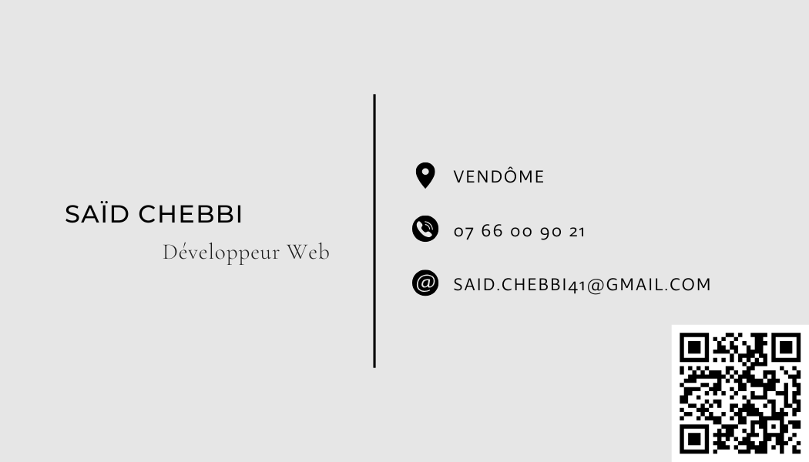
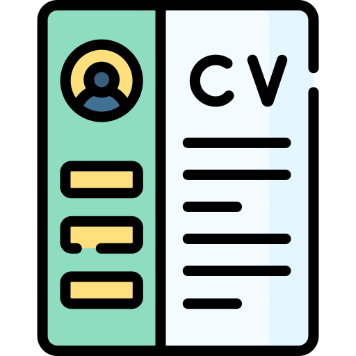

# Formation Développpeur Web et Web Mobile du 25 mars 2025 au 15 janvier 2026

Les apprenants : [Mariam](#mariam-nzeyimana), [Yousra](#lahdar-yousra), [Saïd](#saïd-chebbi), [Alexis](#alexis-moreau), [Yusuf](#yusuf-karaca), [Alexandre Delsol](#alexandre-delsol), [Jason](#jason-perrault), [Kilian](#killian-bastard-lahoreau), [Tristan](#tristan-martin), [Alexandre Dulon](#alexandre-dulon)

# Projets

Liste des projets réalisés par les étudiants de la formation [DWWM](https://gretaformation.ac-orleans-tours.fr/formation/titre-professionnel-developpeur-web-et-web-mobile) à [MAME](https://mame-tours.com/).

## Algorithmique 🧠💻 (Avril 2025)

**Objectif** : Apprendre les bases de l'algorithmique.

**Description** : Réaliser des petits programmes en pseudo-code / javascript.

## CV numérique 💻📄 (Avril 2025)

**Objectif** : Créer une page web simple qui présente votre profil personnel(CV, portfolio) ou un thème fictif (par exemple : un hobby, un produit, ou un événement) en utilisant les principaux éléments de HTML et CSS.

**Description** : Réaliser un CV numérique à peaufiner et présenter aux entreprises.

# Apprenants

<!-- ************************************************************* -->

## Mariam Nzeyimana

👋 Bonjour ! Je m'appelle Mariam Nzeyimana.  
Passionnée par la technologie et le développement web, je suis en pleine reconversion professionnelle pour devenir Développeuse Web.

### 📄 Projets :

<ul>
	<li><a href="https://mariamnze.github.io/cv/">Mon CV  Numérique</a></li>
	<li><a href="https://www.figma.com/design/cd1S2Q8Dz5ioOGL3g18J1g/Pizza?node-id=0-1&t=06A0XhI3ozCO0ncL-1">Figma - Application pour commander des pizzas</a></li>
</ul>

## 🛠️ Compétences :

## 🔗 Liens :

<!-- ************************************************************* -->

## LAHDAR Yousra

Je suis actuellement en reconversion depuis mars 2025 afin de devenir développeur web.
## 📄Projets :
<a href="../../Documents/ cv-yousra/cv1.html">Mon cv version html</a>

## 🛠️Compétences :

## 🔗Liens :

<!-- ************************************************************* -->

## Saïd CHEBBI

Fort d’un parcours riche en expériences variées, incluant la création de mon entreprise, j’ai
choisi de me réorienter vers le métier qui me passionne : le développement web.
Actuellement en formation dans ce domaine, je suis à la recherche d’un stage du 15/09 au
21/11 qui me permettra de mettre en pratique mes compétences et de valider mon bac+2

## 📄Projets :
<ul>
<li>

[Curriculum Vitae](https://chebbis.github.io/CV/)
</li>
<li>
Projet à venir
</li>
</ul>

## 🛠️Compétences :

## 🔗Liens :

<!-- ************************************************************* -->

## Alexis Moreau

 

Je m'appelle Alexis Moreau, j'ai 33 ans et je vis à Tours (37)

Je suis passionné par le domaine du numérique et je suis en train de suivre une formation de développeur web et web mobile au GRETA Centre Val De Loire pour obtenir un titre professionnel Bac +2.

Je suis déterminé et motivé à mettre en pratique mes connaissances dans un cadre professionnel.

En raison de mon intérêt pour les langages de programmation, je suis constamment motivé à apprendre et à m'impliquer dans des projets visant à développer mes compétences.

## 📄Projets :

<ul>
	<li><a href="https://alexis-moreau.fr/Index.html" target="_blank">Projet site CV</a></li>
	<li>Projet à venir</li>
</ul>

## 🛠️Compérences :

## 🔗Liens :

<!-- ************************************************************* -->

## Yusuf Karaca

*Je suis Yusuf Karaca, 24 ans, futur développeur web et web mobile certifié par le GRETA Centre Val de Loire.*

## 📄 Projets :
*Projets à venir.*

## 🛠️ Compétences :

## 🔗 Liens

<!-- ************************************************************* -->

## Alexandre DELSOL

## 📄Projets :

[Mon portfolio](https://alexandre-delsol-dev-portfolio.vercel.app/)

## 🛠️Compétences :
### Frontend

### Backend

### Database

### DevOps & Tools

## 🔗Liens :

<!-- ************************************************************* -->

## Jason PERRAULT:

## Paragraphe de présentation:
Je m'appelle Jason, j'ai 20 ans, je suis en reconversion professionnelle.Je prépare un titre professionnel développeur web et web mobile.
## 📄 Projets:
- Mon CV numérique
- Econumérique 37
## 🛠️ Compétences:

## 🔗 Liens:

<!-- ************************************************************* -->

## Killian Bastard-Lahoreau

Je suis passionné de develppement web. En reconversion depuis mars 2025, Je suis motivé à coder.

### 📄Projets :
<a href="../CVhtml/Index.html">Mon cv version html</a>

### 🛠️Compétences :

### 🔗Liens :

<!-- ************************************************************* -->

## Tristan Martin

Je m'appelle **Tristan Martin** et je suis actuellement en reconversion professionnelle. Passionné par l'informatique et les nouvelles technologies, je suis motivé à apprendre et à évoluer dans le domaine du développement.

## 📄 Projets :

- Réalisation d’un **CV professionnel** : [lien](https://trqr.github.io/CVFormation/).
- Création site e-commerce [Crafty Store](https://trqr.github.io/CVFormation/).

## 🛠️ Compétences :

## 🔗 Liens :

<!-- ************************************************************* -->

## Alexandre Dulon

Actuellement en formation de développeur web/mobile, je suis curieux et motivé à apprendre de nouvelles technologies.

## 📄Projets :

[mon gitsite](https://norstroph.github.io/portfolio/)

## 🛠️Compétences :

## 🔗Liens :

